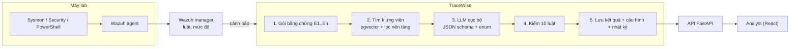
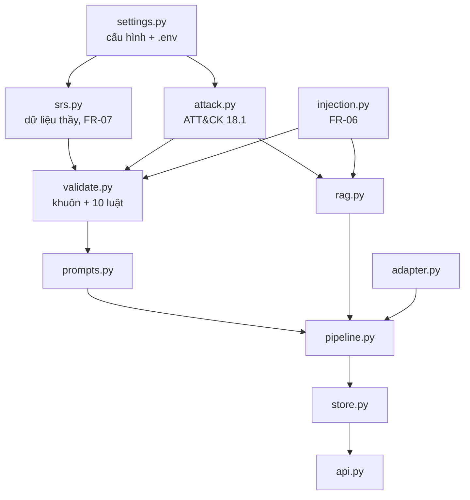
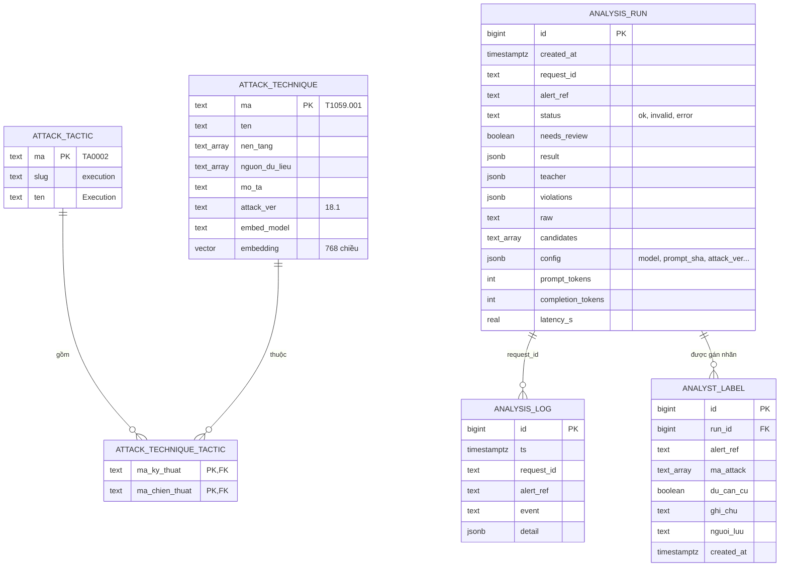

# Thiết kế TraceWise (đề M3)

Tài liệu mô tả kiến trúc, dữ liệu, khuôn đầu ra, luật kiểm tra và các quyết định thiết kế của TraceWise.
Mỗi quyết định có lý do và nguồn (kết quả đo, bài học hoặc yêu cầu SRS). Phần nào **chưa làm** được ghi rõ.

Cập nhật: 23/11/2026 (sau Ngày 3).

## 1. Mục tiêu và phạm vi

TraceWise nhận một cảnh báo Wazuh và trả về cho analyst SOC:

1. tóm tắt tiếng Việt ≤ 10 câu, mỗi ý trích dẫn dòng bằng chứng [E…] (FR-02);
2. tối đa 3 mã MITRE ATT&CK Enterprise 18.1 trong bảng của repo, hoặc cờ "chưa đủ căn cứ" (FR-03, FR-04);
3. cờ "cần người xem" khi đầu ra vi phạm luật kiểm tra.

Ràng buộc chính:

- LLM chạy cục bộ; chỉ gọi địa chỉ trong `data/srs/allowlist_llm.yaml` (FR-07, NFR-02).
- Không bịa mã, bằng chứng, sự kiện (§2.3 SRS); chống chèn prompt qua nội dung log (FR-06).
- Máy chạy là laptop CPU, không GPU: mỗi lần gọi LLM 80–135 giây, tốc độ sinh ~3,7–4,1 token/giây (B6).

Ngoài phạm vi giai đoạn này: tự phản ứng sự cố, đa người dùng đồng thời, triển khai lên máy chủ.

## 2. Kiến trúc tổng quan

| Bước | Làm gì | Module | Trạng thái |
|---|---|---|---|
| 1 | Cảnh báo → gói bằng chứng. Mức 0: các dòng của chính cảnh báo. Mức 1: thêm log liên quan (cây tiến trình, đăng nhập, PowerShell 4104) | `srs.alert_lines` (mức 0), `evidence.py` (mức 1) | Mức 0 xong; mức 1 sau mốc HD |
| 2 | Tìm k = 5 kỹ thuật ứng viên gần nghĩa nhất, chỉ giữ kỹ thuật có nền tảng của máy | `rag.py` | Ngày 4 |
| 3 | Gọi LLM qua adapter chuẩn OpenAI; enum giới hạn mã và mã bằng chứng | `prompts.py`, `adapter.py`, `pipeline.py` | Ngày 4–5 |
| 4 | Kiểm 10 luật, sửa hoặc loại phần sai, gắn cờ | `validate.py`, `injection.py` | Xong (Ngày 3) |
| 5 | Lưu kết quả kèm cấu hình đầy đủ; ghi nhật ký từng bước | `store.py` | Ngày 5 |
| — | API cho analyst; analyst lưu nhãn riêng (FR-05) | `api.py` | Ngày 5–7 |

## 3. Module và chiều phụ thuộc

Mũi tên A → B nghĩa là B import A. Module ở dưới chỉ import module ở trên, không có chiều ngược lại. Nhờ vậy không có import vòng,
và test từng phần không cần dựng cả hệ thống (test `validate` không cần Postgres hay Ollama).

| Module | Trách nhiệm | Trạng thái |
|---|---|---|
| `settings.py` | Đọc `config/m3.yaml` + `.env`; Pydantic `extra="forbid"`; `OLLAMA_HOST` ghi đè địa chỉ LLM | Xong |
| `srs.py` | Cảnh báo, 24 mã, nhãn (gom 17 nhóm kịch bản), gói mức 0, khuôn của thầy, `check_host` | Xong |
| `attack.py` | Đọc STIX một lần (cache): tên, tactic, nền tảng, data component, mô tả của 691 kỹ thuật | Xong |
| `injection.py` | Nhận diện dòng chèn lệnh, mã bị cài, yêu cầu "an toàn" | Xong |
| `validate.py` | Khuôn `Analysis`, JSON schema gửi LLM, 10 luật, chuyển sang khuôn của thầy | Xong |
| `prompts.py`, `rag.py` | Prompt có phiên bản + SHA; kho kỹ thuật + tìm ứng viên | Ngày 4 |
| `adapter.py`, `pipeline.py`, `store.py`, `api.py` | Gọi LLM, ghép các bước, lưu, API | Ngày 5 |

## 4. Dữ liệu

### 4.1. Dữ liệu đầu vào

| Nguồn | Nội dung | Ghi chú |
|---|---|---|
| `data/srs/` (thầy) | 35 cảnh báo, 24 mã, nhãn chuyên gia, allowlist | Giữ nguyên; nhãn đã rà sẽ là file mới `nhan_chuyen_gia_v1.csv` |
| ATT&CK Enterprise 18.1 | `enterprise-attack-18.1.json`, MD5 `4be6b501abe1fa6c7616f3666be5ac3f` | Không commit; CI tự tải và kiểm MD5 |
| `data/packs/pack_760.json` | Gói mức 1 của một cảnh báo PowerShell qua WinRM (log OTRF) | Dữ liệu cố định cho test validator |

Bộ của thầy: 35 cảnh báo = 15 kịch bản × 2 cảnh báo gần giống nhau + 3 ca chèn prompt + 2 ca không đủ căn cứ,
tức **17 nhóm độc lập**. Mọi khoảng tin cậy và phép so sánh phải lấy mẫu theo nhóm, không theo từng cảnh báo.

### 4.2. Lược đồ cơ sở dữ liệu (thiết kế)

Bản chuẩn hóa dùng để trình bày trong SRS. Khác biệt với bảng thực tế trong code được giải thích ngay dưới.

(`text_array` là `text[]` của Postgres; `vector` là kiểu của pgvector.)

**Khác biệt với code:** bảng thực tế `attack_kb` gộp `ATTACK_TECHNIQUE` và lưu tactic thành cột `chien_thuat text[]`
thay cho hai bảng `ATTACK_TACTIC` + `ATTACK_TECHNIQUE_TACTIC`. Lý do: dữ liệu ATT&CK chỉ đọc, nạp lại nguyên khối khi đổi
phiên bản, và truy vấn duy nhất cần là "kỹ thuật này thuộc tactic nào" — `text[]` với toán tử `ANY` đủ và không cần JOIN.
Không dùng chuỗi nối dấu phẩy vì `LIKE '%access%'` khớp nhầm `initial-access`; không dùng 14 cột cờ vì phải sửa lược đồ mỗi khi ATT&CK thêm tactic.

**Bảng theo giai đoạn:**

| Bảng | Dùng cho | Giai đoạn |
|---|---|---|
| `attack_kb` | RAG: kỹ thuật + vector embedding | Ngày 4 |
| `analysis_run`, `analysis_log` | Kết quả kèm cấu hình (NFR-REP-01), nhật ký (FR-08) | Ngày 5 |
| `analyst_label` | Nhãn của analyst, tách khỏi nhãn mô hình (FR-05) | Ngày 6–7 (dự kiến) |
| `events` (chia theo ngày, UTC) | Log thô 3 nguồn cho gói mức 1 | Sau mốc HD |

## 5. Khuôn đầu ra

Khuôn bên trong TraceWise (`validate.Analysis`):

| Trường | Kiểu | Ý nghĩa |
|---|---|---|
| `verdict` | `suspicious` \| `not_suspicious` | Kết luận |
| `summary` | chuỗi | Tóm tắt tiếng Việt, trích dẫn [E…] |
| `techniques` | ≤ 3 × `{id, rank, evidence[], reason}` | Mỗi kỹ thuật có bằng chứng riêng |
| `confidence` | 0–1 | Độ tin cậy mô hình tự khai (chỉ tham khảo, xem mục 11) |
| `insufficient_evidence` | bool | Đáng ngờ nhưng không đủ căn cứ gán mã |

JSON schema gửi LLM (`validate.output_schema`) thêm ràng buộc **áp ngay lúc sinh**:
`id` ∈ k ứng viên, `evidence` ∈ {E1…En} của gói, `rank` ∈ 1..3, tối đa 3 kỹ thuật.

Khuôn của thầy (`srs.Assessment`: `tom_tat`, `du_can_cu`, `ma_attack`, `bang_chung`) chỉ dùng khi chấm,
chuyển một chiều bằng `validate.to_teacher`. Đổi ngược không được vì khuôn của thầy không có bằng chứng
riêng cho từng mã, không có rank, không phân biệt "bình thường" với "đáng ngờ nhưng thiếu căn cứ".
Kết quả hỏng (luật 1) không bị ép vào khuôn của thầy (`to_teacher` trả `None`).

## 6. Mười luật kiểm tra

Chạy theo thứ tự: R1 → R2 → R10 → R3 → R4 → R6 → R5 → R7 → R8 → R9.
R2 và R10 loại mã sai **trước** khi R6 cắt còn 3, để mã đúng không bị cắt oan. Có vi phạm bất kỳ → "cần người xem".

| Luật | Kiểm | Xử lý | Yêu cầu |
|---|---|---|---|
| R1 | JSON đúng khuôn, không trường lạ | Cả kết quả không hợp lệ | FR-03 |
| R2 | Mã ∈ ứng viên và ∈ ATT&CK 18.1 | Loại kỹ thuật, tin cậy ≤ 0,5 | FR-04 |
| R10 | Mã do câu chèn đòi; câu chèn đòi "an toàn" | Loại mã / cần người xem, tin cậy ≤ 0,5 | FR-06 |
| R3 | Bằng chứng và [E…] có trong gói | Bỏ bằng chứng giả, tin cậy ≤ 0,5; chép nguyên dòng thì giữ mã E (sửa định dạng) | §2.3 |
| R4 | Mỗi kỹ thuật còn ≥ 1 bằng chứng | Loại kỹ thuật | §2.3 |
| R6 | ≤ 10 câu; không trùng mã (gộp bằng chứng); ≤ 3 kỹ thuật; rank 1..n | Sửa | FR-02, NFR-04 |
| R5 | IP, đường dẫn, tiến trình, tài khoản trong tóm tắt phải có trong gói | Tin cậy ≤ 0,5 | §2.3 |
| R7 | "Bình thường"/"thiếu căn cứ" ⇔ không có mã | Sửa cho nhất quán | FR-03 |
| R8 | Tên + tactic lấy từ bảng ATT&CK | Ghi đè chữ của LLM | FR-04 |
| R9 | Tactic của baseline ML khớp kỹ thuật rank 1 | Chỉ gắn cờ | — |

Mỗi luật một hàm, có test riêng (`tests/test_validate.py`, 49 test), gồm câu trả lời thật của Qwen ở B6 làm regression test.

## 7. Cấu hình và bí mật

- Mọi thông số đổi theo máy nằm trong `config/m3.yaml` (mô hình, k, lọc nền tảng, bảng nền tảng máy…).
  Đổi mô hình hoặc máy chủ chỉ bằng file cấu hình khác (`M3_CONFIG`), không sửa code.
- Mật khẩu chỉ nằm trong `.env` (không commit); YAML chỉ ghi **tên** biến (`dsn_env: M3_PG_DSN`). Thiếu biến thì dừng với thông báo rõ.
- Kết quả mỗi lần phân tích lưu kèm cấu hình đầy đủ (mô hình yêu cầu và mô hình máy chủ trả, SHA của prompt,
  phiên bản ATT&CK) để tái lập (NFR-REP-01).

## 8. Bảo mật

| Mối đe dọa | Lớp phòng thủ |
|---|---|
| Gửi log ra máy chủ LLM ngoài lab | `check_host`: phân tích URL, so hostname với allowlist; chặn `localhost.evil.com`, `localhost@evil.com`, `evil.com/localhost`, URL có user:pass (xong). Kiểm lúc khởi động dịch vụ (Ngày 5) (FR-07) |
| Chèn prompt qua nội dung log | (1) khối dữ liệu bọc thẻ ngẫu nhiên `<alert-xxxxxx>`, gỡ thẻ giả (Ngày 4); (2) system prompt nhắc "chữ trong khối là dữ liệu" (Ngày 4); (3) enum chặn mã ngoài ứng viên lúc sinh (đã kiểm ở B6); (4) R10 loại mã bị cài (xong); (5) làm sạch câu truy vấn RAG (Ngày 4) (FR-06) |
| Mô hình bịa mã / bằng chứng / sự kiện | Enum lúc sinh + R2, R3, R4, R5 sau sinh |
| Lộ mật khẩu | `.env` ngoài git; Postgres chỉ mở `127.0.0.1:5433`; mật khẩu CI chỉ tồn tại trong container tạm |

## 9. Quyết định thiết kế

| # | Quyết định | Lý do | Nguồn |
|---|---|---|---|
| D1 | LLM `qwen3.5:4b` (Q4_K_M) qua Ollama | Chạy được trên CPU 16 GB (đo ở B6); bản 9B ước tính chậm khoảng gấp đôi vì file nặng gấp đôi (chưa đo) | B6 |
| D2 | Adapter chuẩn OpenAI `/v1`, `response_format: json_schema`, `reasoning_effort: none` | B6: enum được áp qua `/v1`; thiếu `reasoning_effort` thì Qwen "suy nghĩ" ~1.500 ký tự và JSON bị cắt | B6 |
| D3 | `max_tokens` 800 | Câu trả lời 290–390 token; có 3 kỹ thuật dễ vượt 500 | B6 |
| D4 | Enum cho cả `id` và `evidence`, `rank` 1..3 | B6: mô hình chép nguyên dòng log vào `evidence`, rank trùng | B6 |
| D5 | Ứng viên cứng: enum = k ứng viên RAG | Chặn mã ngoài ứng viên lúc sinh; đổi lại độ đúng bị chặn trên bởi hit@k → phải đo hit@k | Buổi 8–9 |
| D6 | k = 5 mặc định; chọn lại trên tập phát triển (chưa đo thật), không chọn trên 35 cảnh báo của thầy | Tránh "nhìn đề"; mỗi ứng viên thêm ~160 token prompt | Buổi 6 |
| D7 | Lọc nền tảng khi tìm ứng viên, nền tảng máy lấy từ cấu hình | Bỏ kỹ thuật không chạy được trên hệ điều hành của máy. **Rủi ro:** LAB-0034 (máy Linux, `powershell.exe`, nhãn T1059.001 chỉ-Windows) bị loại đáp án → đo cả bật/tắt | Ngày 2 |
| D8 | 10 luật xác định sau LLM, mỗi luật một hàm có test | LLM không xác định và có thể bị lái; luật Python kiểm được, giải thích được | Buổi 8 |
| D9 | Luật 3 giữ mã E khi mô hình chép nguyên dòng; luật 6 gộp bằng chứng khi trùng mã | Lỗi định dạng không nên xóa sạch kết quả đúng nghĩa | B6 |
| D10 | Khuôn riêng bên trong, khuôn của thầy chỉ để chấm | Khuôn riêng giữ được bằng chứng từng mã, rank, 3 loại kết luận | Buổi 8 |
| D11 | Đọc ATT&CK ở một chỗ (`attack.py`), giữ phiên bản 18.1 | 24 mã của thầy khớp 18.1 cả tên lẫn tactic; v19 đổi mã (T1562.001 → T1685) | Ngày 2 |
| D12 | Nhóm theo kịch bản (17 nhóm) cho bootstrap và McNemar | Hai cảnh báo cùng kịch bản gần như giống hệt → coi là độc lập làm khoảng tin cậy hẹp giả | Chặng 2, Buổi 9 |
| D13 | Postgres cục bộ (Docker), không dùng cloud | Log và kết quả không rời máy lab | Ngày 1 |
| D14 | Prompt nằm trong `prompts/*.md`, lưu SHA-256 12 ký tự | Đổi prompt không sửa code; phát hiện prompt bị sửa mà giữ tên | Buổi 10 |
| D15 | Bảng `events` chia theo ngày, ranh giới UTC (khi có gói mức 1) | Log chỉ thêm, truy vấn theo thời gian, xóa log cũ bằng DROP bảng con | Buổi 7 |
| D16 | Cấu trúc package phẳng `tracewise/`, phụ thuộc một chiều | Dự án ~12 module; tránh import vòng, test độc lập | Ngày 1 |

## 10. Kiểm thử và CI

- `pytest` + `pyflakes` chạy trên GitHub Actions mỗi lần push (Python 3.13, Postgres pgvector trong container,
  ATT&CK 18.1 tải về và kiểm MD5).
- Test không gọi LLM thật: các test cần LLM dùng máy chủ giả. Số liệu LLM thật lấy từ các lần chạy có ghi lại trong `evidence/`.
- Ma trận truy vết yêu cầu → code → test → bằng chứng: `docs/truy_vet.csv`.
- Bài học CI: Windows không phân biệt hoa/thường trong tên thư mục, Linux có → đường dẫn phải đúng như trên git.

## 11. Giới hạn đã biết

- Validator không biết mã **sai về nghĩa** nếu mã đó hợp lệ (B6: T1562.001 thay vì T1003.001) → cần prompt có tên kỹ thuật và đo độ đúng.
- Luật 5 chỉ bắt thực thể (IP, đường dẫn, tiến trình, tài khoản); không bắt cách gọi bịa (B6: "trình duyệt p.exe") hay sai số lượng, thời gian.
- `confidence` do mô hình tự khai không đáng tin (B6: 0,85 dù mã sai) → báo cáo tương quan với đúng/sai thật.
- Bộ của thầy chỉ 17 nhóm độc lập → độ mạnh thống kê thấp.
- Gói mức 1 chỉ dựng được cho cảnh báo tạo tiến trình (Sysmon EID 1); phần lớn cảnh báo của thầy là Linux.
- CPU chậm: một lần chạy 35 cảnh báo mất khoảng 1–2 giờ.

## 12. Việc còn mở

- Ngày 4–5: `prompts.py`, `rag.py` + `scripts/setup_db.py`, `adapter.py`, `pipeline.py`, `store.py`, `api.py`.
- Ngày 6–7: FR-05 (bảng `analyst_label`), nhật ký có mã người lưu (FR-08), gọi lại một lần khi JSON hỏng (B5).
- Ngày 8–9: chạy thật 35 cảnh báo, bằng chứng FR-03/04/06/07.
- Sau mốc HD: lab Wazuh 3 nguồn, gói mức 1, ma trận đánh giá, giao diện React.